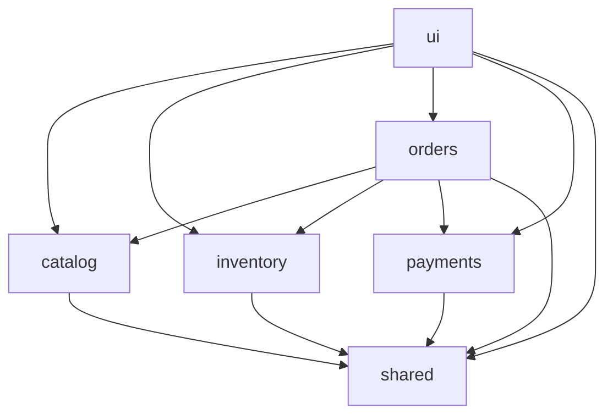

# Retail Store Modulith

A specification-driven migration of the [Spring Boot Microservices Series](https://github.com/rajadilipkolli/spring-boot-microservices-series-v2) to a modular monolith architecture powered by **Spring Modulith**, **Java 25**, and **Spring Boot 4.1.1**.

---

## Table of Contents

- [Project Overview](#project-overview)
- [Technology Stack](#technology-stack)
- [Architecture & Business Modules](#architecture--business-modules)
- [Module Boundaries & Architecture Rules](#module-boundaries--architecture-rules)
  - [Dependency Rules](#dependency-rules)
  - [Schema & Persistence Isolation](#schema--persistence-isolation)
  - [Transactions, Consistency & Resiliency](#transactions-consistency--resiliency)
- [Repository Guide & Documentation](#repository-guide--documentation)
- [Getting Started & Build Commands](#getting-started--build-commands)
  - [Prerequisites](#prerequisites)
  - [Key Maven Commands](#key-maven-commands)
  - [Specification & Architecture Verification](#specification--architecture-verification)
- [Specification-Driven Development (SDD) Workflow](#specification-driven-development-sdd-workflow)
- [Migration Phase Discipline](#migration-phase-discipline)
- [AI Coding Assistant Guide](#ai-coding-assistant-guide)

---

## Project Overview

The objective of this repository is to evolve the existing retail store microservices into an architecturally clean, maintainable, and observable **Spring Modulith** application while strictly preserving:
- **Business Behavior & Contracts:** All core domain logic, REST API contracts, and validation rules remain intact.
- **Data Integrity & Schema Isolation:** Dedicated database schemas per module with zero direct cross-schema queries.
- **Reliability & Idempotency:** Asynchronous communication decoupled through outbox patterns and message queues.

The migration follows **Specification-Driven Development (SDD)** and **Test-Driven Development (TDD)**. Every architectural change and module migration is guided by formal specifications under `spec/`, backed by executable acceptance criteria, and verified continuously via automated unit, integration, and architecture tests.

---

## Technology Stack

| Layer / Concern          | Technology                   | Details / Configuration                                          |
|--------------------------|------------------------------|------------------------------------------------------------------|
| **Runtime & Language**   | **Java 25**                  | OpenJDK 25 with preview features enabled where needed            |
| **Framework**            | **Spring Boot 4.1.1**        | WebMVC, Data JPA, Validation, AMQP                               |
| **Modulith Core**        | **Spring Modulith 2.1.1**    | Module boundaries, arch verification, event publication          |
| **Database**             | **PostgreSQL 18**            | Schema isolation per domain module, runtime driver `postgresql`  |
| **Database Migrations**  | **Liquibase**                | XML master changelog with modular changeset includes             |
| **Messaging & Broker**   | **RabbitMQ 4**               | Correlated publisher confirms, event externalization             |
| **Transactional Outbox** | **NamaStack Outbox**         | `spring-modulith-starter-namastack` + AMQP externalization       |
| **ORM Utilities**        | **Hypersistence Utils**      | `hypersistence-utils-hibernate-73` (v3.16.0)                     |
| **Testing**              | **Testcontainers & JUnit 5** | Testcontainers PostgreSQL, RabbitMQ, Spring Modulith Test        |
| **Code Formatting**      | **Spotless**                 | `google-java-format` (1.36.1) in **AOSP** style, license checks  |
| **Test Coverage**        | **JaCoCo**                   | Minimum **80%** complexity coverage threshold enforced on verify |

---

## Architecture & Business Modules

The application is structured into clearly separated business, orchestration, and support modules rooted under `com.example.retail`:

```
com.example.retail
├── catalog/       # Catalog business module (owns 'catalog' schema)
├── inventory/     # Inventory business module (owns 'inventory' schema)
├── orders/        # Orders orchestration module (order lifecycle & sagas)
├── payments/      # Payments business module (financial accounts & charges)
├── shared/        # Shared kernel (OPEN module: common DTOs, events, primitives)
└── ui/            # UI presentation module (controllers, views, and web assets)
```

### Module Responsibilities

- **`catalog` (`com.example.retail.catalog`)**
  - Manages product master data, descriptions, pricing, and catalog search.
  - Owns the dedicated `catalog` database schema.
  - Exposes public APIs for product information retrieval; internal implementation is strictly encapsulated.

- **`inventory` (`com.example.retail.inventory`)**
  - Manages stock levels, quantity reservations, stock release, and replenishment.
  - Owns the dedicated `inventory` database schema (`inventory`, `inventory_reservations`).
  - Implements concurrency control, reservation state transitions, and asynchronous event outbox processing.

- **`orders` (`com.example.retail.orders`)**
  - Orchestrates the order lifecycle and cross-module checkout workflows.
  - Coordinates reservations with `inventory`, validations with `catalog`, and charges with `payments`.
  - Implements compensation logic for partial order failures.

- **`payments` (`com.example.retail.payments`)**
  - Handles customer balances, payment authorizations, capture, and refunds.
  - Owns financial state and transaction records.

- **`shared` (`com.example.retail.shared`)**
  - An **`OPEN`** module (`ApplicationModule.Type.OPEN`) accessible by all modules.
  - Contains shared domain primitives, common integration events (`InventoryProcessedEvent`, etc.), and pagination models (`PagedResult`).

- **`ui` (`com.example.retail.ui`)**
  - Presentation layer managing web views, controllers, and integration for the retail storefront.
  - Consumes public APIs across modules.

---

## Module Boundaries & Architecture Rules

Module boundaries are formally enforced by **Spring Modulith** and validated automatically via `ModulithArchitectureTests`.

### Dependency Rules



1. **Intended Dependency Direction:**
   - **`orders`** may depend on the public APIs of **`catalog`**, **`inventory`**, and **`payments`**.
   - **`catalog`**, **`inventory`**, and **`payments`** **MUST NOT** depend on `orders`, including its public APIs or internal packages.
   - **`catalog`** and **`inventory`** maintain strict independence (except explicitly permitted read-only catalog lookups where specified).
   - **`shared`** is an open contract module and must never depend on any business module.
2. **Encapsulation & Public APIs:**
   - Only classes in the module's root package (or explicitly documented public API packages) are accessible externally.
   - Packages named `internal/**` are strictly private to each module.
   - Cross-module communication must use immutable DTOs or application events.
   - Direct JPA entity or repository sharing between modules is strictly prohibited.
3. **No Circular Dependencies:**
   - Cyclic package and module relationships are forbidden and fail architectural verification during the build.

### Schema & Persistence Isolation

- **Independent Schemas:** PostgreSQL database isolation is enforced using separate database schemas for each module:
  - `catalog` schema for product catalog entities.
  - `inventory` schema for inventory items and reservations.
  - Additional schemas for orders and payments as phases progress.
- **No Cross-Schema Queries or Joins:** A module must never query another module's tables directly.
- **Liquibase Migrations:** Managed per module in `src/main/resources/db/changelog/{module}/` and referenced cleanly in `db.changelog-master.xml`.

### Transactions, Consistency & Resiliency

- **Atomic Module Transactions:** Local database transactions (`@Transactional`) are scoped strictly to a single module's boundary.
- **Asynchronous & Cross-Module Consistency:** Cross-boundary interactions rely on the **Transactional Outbox Pattern** (`spring-modulith-starter-namastack`) and **RabbitMQ** to publish application events durably.
- **Explicit Failure Compensation:** Distributed business processes (such as order checkout) must handle failures via explicit, idempotent compensation steps. A local database rollback cannot reverse an external payment or third-party side effect.

---

## Repository Guide & Documentation

| Path | Purpose |
|---|---|
| [`AGENTS.md`](file:///c:/tools/git/retail-store-modulith/AGENTS.md) | Shared engineering rules and constraints for all AI coding assistants |
| [`GEMINI.md`](file:///c:/tools/git/retail-store-modulith/GEMINI.md) | Gemini CLI instructions and SDD compliance rules |
| [`spec/spring-modulith-migration.md`](file:///c:/tools/git/retail-store-modulith/spec/spring-modulith-migration.md) | Master migration specification and architectural blueprint |
| [`spec/execution-status.md`](file:///c:/tools/git/retail-store-modulith/spec/execution-status.md) | Phase status tracking, blockers, and verification evidence |
| [`spec/01-modulith-foundation.md`](file:///c:/tools/git/retail-store-modulith/spec/01-modulith-foundation.md) | Phase 1: Modulith Foundation & architecture verification |
| [`spec/02-catalog-module.md`](file:///c:/tools/git/retail-store-modulith/spec/02-catalog-module.md) | Phase 2: Catalog Module migration |
| [`spec/03-inventory-module.md`](file:///c:/tools/git/retail-store-modulith/spec/03-inventory-module.md) | Phase 3: Inventory Module migration |
| [`spec/04-payments-module.md`](file:///c:/tools/git/retail-store-modulith/spec/04-payments-module.md) | Phase 4: Payments Module migration |
| [`spec/05-orders-orchestration.md`](file:///c:/tools/git/retail-store-modulith/spec/05-orders-orchestration.md) | Phase 5: Orders Orchestration & checkout workflow |
| [`spec/06-api-and-deployment.md`](file:///c:/tools/git/retail-store-modulith/spec/06-api-and-deployment.md) | Phase 6: API Compatibility, security, and deployment assets |
| [`spec/07-migration-verification.md`](file:///c:/tools/git/retail-store-modulith/spec/07-migration-verification.md) | Phase 7: Cutover readiness, parity testing, and verification |
| [`ai/skills/`](file:///c:/tools/git/retail-store-modulith/ai/skills/) | Reusable SDD, Spring Modulith, TDD, and verification skills |
| [`architecture/decisions/`](file:///c:/tools/git/retail-store-modulith/architecture/decisions/) | Architecture Decision Records (ADRs) |
| [`tools/verify-specs.py`](file:///c:/tools/git/retail-store-modulith/tools/verify-specs.py) | Python validator for specification consistency and link integrity |

---

## Getting Started & Build Commands

### Prerequisites

- **Java Development Kit (JDK):** Version 25 or higher
- **Container Runtime:** Docker Desktop, Rancher Desktop, or Podman (required for Testcontainers integration tests)
- **Python:** Python 3.10+ (for `verify-specs.py`)

### Key Maven Commands

The project includes the Maven wrapper (`./mvnw` or `mvnw.cmd` on Windows):

- **Compile and verify code formatting:**
  ```bash
  ./mvnw compile
  ```

- **Run unit tests:**
  ```bash
  ./mvnw test
  ```

- **Run Spring Modulith architecture verification tests:**
  ```bash
  ./mvnw test -Dtest=ModulithArchitectureTests
  ```

- **Run integration tests (failsafe):**
  ```bash
  ./mvnw integration-test
  ```

- **Run complete build verification (tests, integration tests, JaCoCo, Spotless):**
  ```bash
  ./mvnw verify
  ```

- **Check code formatting with Spotless:**
  ```bash
  ./mvnw spotless:check
  ```

- **Apply code formatting automatically (AOSP style + license header):**
  ```bash
  ./mvnw spotless:apply
  ```

### Specification & Architecture Verification

Always validate specifications and architecture definitions before and after changes:

```bash
# Validate specification references, skills, and ADR metadata
python tools/verify-specs.py

# Check Python syntax for validator
python -m py_compile tools/verify-specs.py
```

---

## Specification-Driven Development (SDD) Workflow

All development in this repository strictly adheres to SDD:

1. **Review Specification:** Identify the active migration phase in `spec/` and review all prerequisite criteria.
2. **Translate to Tasks:** Break acceptance criteria into targeted implementation and test tasks.
3. **Test-First Implementation (TDD):**
   - **Red:** Write failing tests reflecting acceptance criteria.
   - **Green:** Implement the minimum code required to pass.
   - **Refactor:** Clean code while preserving behavior and running Spotless.
4. **Architectural Verification:** Run `ModulithArchitectureTests` to verify boundary compliance.
5. **Record Evidence:** Record test runs and verification results in [`spec/execution-status.md`](file:///c:/tools/git/retail-store-modulith/spec/execution-status.md).

---

## Migration Phase Discipline

| Phase | Module / Focus | Status | Specification |
|:---:|---|:---:|---|
| **1** | Modulith Foundation & Architecture Verification | `COMPLETE` | [`spec/01-modulith-foundation.md`](file:///c:/tools/git/retail-store-modulith/spec/01-modulith-foundation.md) |
| **2** | Catalog Module | `COMPLETE` | [`spec/02-catalog-module.md`](file:///c:/tools/git/retail-store-modulith/spec/02-catalog-module.md) |
| **3** | Inventory Module | `IN_PROGRESS` | [`spec/03-inventory-module.md`](file:///c:/tools/git/retail-store-modulith/spec/03-inventory-module.md) |
| **4** | Payments Module | `NOT_STARTED` | [`spec/04-payments-module.md`](file:///c:/tools/git/retail-store-modulith/spec/04-payments-module.md) |
| **5** | Orders Orchestration & Checkout | `NOT_STARTED` | [`spec/05-orders-orchestration.md`](file:///c:/tools/git/retail-store-modulith/spec/05-orders-orchestration.md) |
| **6** | API Compatibility & Deployment | `NOT_STARTED` | [`spec/06-api-and-deployment.md`](file:///c:/tools/git/retail-store-modulith/spec/06-api-and-deployment.md) |
| **7** | Migration Verification & Cutover Readiness | `NOT_STARTED` | [`spec/07-migration-verification.md`](file:///c:/tools/git/retail-store-modulith/spec/07-migration-verification.md) |

> [!IMPORTANT]
> Do not retire legacy microservices or delete deployment assets until Phase 7 verification is complete and explicit stakeholder approval is recorded.

---

## AI Coding Assistant Guide

When working with an AI coding assistant (Gemini CLI, Claude Code, GitHub Copilot), use this standard kick-off prompt:

```text
We are using Specification-Driven Development (SDD) to migrate this retail application toward Spring Modulith.

Before changing any files:
1. Read AGENTS.md and GEMINI.md.
2. Read spec/spring-modulith-migration.md.
3. Read the applicable phase specification in spec/.
4. Read ai/skills/spec-driven-development/SKILL.md and ai/skills/spring-modulith/SKILL.md.
5. Inspect the current working tree, source code, Maven configuration, tests, and database changelogs.

Workflow rules:
- Respect module boundaries and allowedDependencies defined in package-info.java files.
- Ensure schema isolation (catalog, inventory, orders, payments schemas).
- Implement changes using test-driven development.
- Run ModulithArchitectureTests and verify code formatting with Spotless.
- Update spec/execution-status.md with test evidence and results.
```
